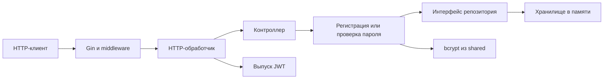

# Архитектура GophKeeper

GophKeeper задуман как клиент-серверный менеджер паролей. В текущем дереве реализован серверный прототип регистрации и входа. CLI, хранение пользовательских секретов, их синхронизация и защищённые маршруты относятся к целевой системе. Полный набор требований описан в [спецификации](docs/Specifications.md).

## Модули и слои

В `backend/services/` находятся два Go-модуля. [auth](backend/services/auth/) содержит HTTP-сервис на Gin. [shared](backend/services/shared/) предоставляет обёртки над bcrypt, HTTP-middleware для логирования и обработки ошибок, а также небольшие утилиты.

| Слой в модуле auth | Ответственность |
| --- | --- |
| `cmd/`, `internal/app/` | Запускают приложение и настраивают Gin, middleware и маршруты. |
| `internal/transport/http/` | Читает JSON, вызывает сценарии через контроллер и формирует HTTP-ответ. Здесь же выпускается JWT. |
| `internal/usecase/` | Проверяет входные данные, регистрирует пользователя и сверяет пароль при входе. |
| `internal/domain/` | Описывает пользователя и интерфейс репозитория, через который работают сценарии. |
| `internal/infrastructure/repository/memory/` | Реализует создание и поиск пользователей в памяти процесса. |

## Запуск и зависимости

Точка входа [cmd/main.go](backend/services/auth/cmd/main.go) вызывает [app.Run](backend/services/auth/internal/app/app.go). Приложение добавляет middleware журналирования, обработки ошибок и восстановления после паники, подключает маршруты под `/api` и слушает порт 8080.

При подключении маршрутов [router.go](backend/services/auth/internal/transport/http/router.go) вызывает `WireInitHandler`. Google Wire генерирует эту функцию по провайдерам из [wire.go](backend/services/auth/internal/transport/http/wire.go). Два сценария получают общий экземпляр репозитория, а HTTP-обработчик получает контроллер и JWT-сервис. Генерация выполняется перед сборкой. Порядок локальной настройки описан в [AGENTS.md](AGENTS.md).

## Регистрация и вход

Оба маршрута принимают JSON с полями `login` и `password`. [Обработчик](backend/services/auth/internal/transport/http/handler.go) декодирует запрос, а контроллер преобразует его в аргументы соответствующего сценария.

1. **`POST /api/auth/register`.** [CreateUserUseCase](backend/services/auth/internal/usecase/create_user.go) проверяет, что логин и пароль заполнены, вычисляет bcrypt-хеш и передаёт пользователя в репозиторий. [Репозиторий](backend/services/auth/internal/infrastructure/repository/memory/memory.go) проверяет уникальность логина, назначает числовой ID и сохраняет запись с хешем пароля.
2. **`POST /api/auth/login`.** [VerifyUserUseCase](backend/services/auth/internal/usecase/verify_user.go) ищет пользователя по логину, сравнивает пароль с сохранённым bcrypt-хешем и возвращает ID при совпадении.
3. **Успешный ответ.** Обработчик выпускает подписанный HS256 токен с ID пользователя и сроком действия. Оба маршрута возвращают `202 Accepted` без тела и передают токен в заголовке `JWT`. Ошибки, переданные через `ctx.Error`, общее middleware журналирует и преобразует в HTTP-ответ через [MapError](backend/services/auth/internal/transport/http/map_error.go).

Примеры запросов находятся в [auth/test](backend/services/auth/test/). Для ручной проверки укажите одинаковый непустой тестовый пароль в обоих запросах и сначала выполните регистрацию.

## Границы текущей реализации

Учётные записи существуют только в памяти экземпляра сервиса и исчезают при перезапуске. JWT используется для выдачи токенов, а метод проверки `Parse` пока остаётся заглушкой. Блокеры сборки, безопасности и выпуска перечислены в [TODO.md](TODO.md).
